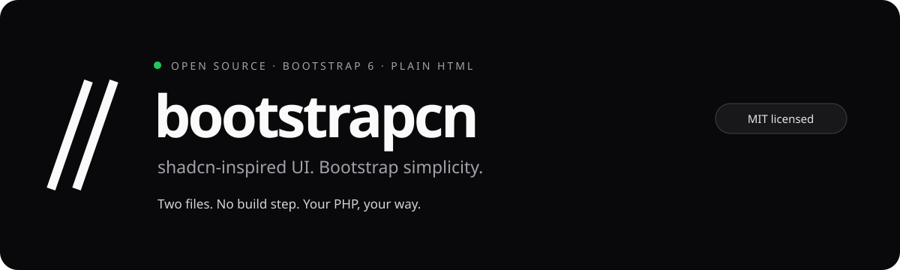

# bootstrapcn



[](https://github.com/soumit101/bootstrapcn/actions/workflows/ci.yml)
[](LICENSE)
[](https://getbootstrap.com/)

**Beautiful components for plain HTML and PHP. Copy two files. Start building.**

[Live component gallery](https://soumit101.github.io/bootstrapcn/) · [Documentation](https://soumit101.github.io/bootstrapcn/docs/guide.html) · [Download](https://github.com/soumit101/bootstrapcn/releases/latest) · [Contribute](CONTRIBUTING.md)

A shadcn/ui-inspired HTML component library built on **Bootstrap 6.0.0-alpha.1**. Use it in raw PHP, Laravel, or any server-rendered HTML application with two local assets. No React, Tailwind, Node, Sass, npm, or compilation is required by your application.

- **53 example groups, 66 named patterns:** forms, dialogs, tables, calendars, menus, charts and more.
- **10 palettes:** light, dark and system modes with persisted preferences.
- **Local assets:** Bootstrap and its JavaScript dependencies are bundled. No runtime CDN requests.
- **Built for contribution:** MIT license, documented component contracts, issue templates and automated checks.

This is an independent implementation of the visual style and common component patterns, not the official shadcn/ui package or a React API port. Bootstrap 6 is a prerelease: the assets are pinned so upstream changes cannot silently break your application.

## Install in PHP

Download the [latest release](https://github.com/soumit101/bootstrapcn/releases/latest) or clone this repository. Copy the complete `dist` folder to your public directory, for example `public/assets/bootstrapcn/`. It contains ready-to-use CSS and JavaScript plus licenses and an integrity manifest.

```html
<!doctype html>
<html lang="en" data-bs-theme="light">
<head>
  <meta charset="utf-8">
  <meta name="viewport" content="width=device-width, initial-scale=1">
  <link rel="stylesheet" href="/assets/bootstrapcn/bootstrapcn.css">
  <script type="module" src="/assets/bootstrapcn/bootstrapcn.js"></script>
</head>
<body>
  <button type="button" class="sc-button"
          data-sc-toast="Saved" data-sc-description="Your changes are ready.">
    Show notification
  </button>
</body>
</html>
```

Both assets include Bootstrap. **Do not also load Bootstrap 5 or another Bootstrap 6 bundle.** Adjust URLs for your application's public root or subdirectory. Keep `type="module"`: Bootstrap 6 ships ES modules, and browsers load them directly without a bundler. Serve through HTTP/HTTPS with a JavaScript MIME type; `file://` is not supported for module scripts. The files make no CDN or font requests.

Open `index.html` through your web server for **53 component example groups covering 66 catalog patterns**, each with a live preview and copyable HTML. The searchable [coverage map](docs/coverage.json) tracks every pattern against the shadcn component index reviewed on October 23, 2026. `examples/starter.php` demonstrates POST handling, escaped output, CSRF protection, server validation, retained values, labels and errors. It does not save to a database. PHP 7.4+ is recommended; a PHP runtime is needed only to execute the starter.

## Included components

| Pattern | Markup / behavior |
| --- | --- |
| Button | `.sc-button`; `-secondary`, `-outline`, `-ghost`, `-link`, `-destructive`; sizes `-sm`, `-lg`, `-icon` |
| Card | Bootstrap `.card`, `.card-header`, `.card-body`, `.card-footer`; `.card-description` |
| Input, textarea, field | `.form-control`, `.sc-field`, `.sc-field-description`, `.sc-field-error` |
| Select | Native `<select class="sc-select" name="…">` |
| Combobox | Bootstrap 6 `data-bs-toggle="combobox"`, `.combobox-value`, `.menu-item[data-bs-value]`; `data-bs-name` supplies POST field |
| Checkbox, radio, switch, slider | Native inputs with `.sc-checkbox`, `.sc-radio`, `.sc-switch`, `.sc-range` |
| Badge, avatar | `.sc-badge`, `.sc-avatar`, `.sc-avatar-group` |
| Dialog / alert dialog | Bootstrap `<dialog class="dialog">`; `data-bs-toggle="dialog"`, `data-bs-target`, `data-bs-dismiss="dialog"` |
| Sheet / drawer | Bootstrap `<dialog class="drawer drawer-end">`, `data-bs-toggle="drawer"` |
| Dropdown menu | Bootstrap `data-bs-toggle="menu"` followed by `.menu` |
| Tabs | Bootstrap `.nav.sc-tabs`, `data-bs-toggle="tab"`, `.tab-content`, `.tab-pane` |
| Accordion / collapsible | Native `<details>` and `<summary>` inside `.sc-accordion` |
| Alert | `.sc-alert`, optional `.sc-alert-destructive`; appropriate `role` |
| Toast | `data-sc-toast` or `BootstrapCN.toast()` |
| Tooltip / popover | Bootstrap data attributes; initialized automatically |
| Table / scroll area | `.sc-table` inside `.sc-scroll-area`; semantic table markup |
| Progress | Native `<progress class="sc-progress" value="64" max="100">` |
| Skeleton | `.sc-skeleton`; respects reduced motion |
| Toggle | `data-sc-toggle`, `aria-pressed="false"`; emits `sc:toggle` |
| Breadcrumb / pagination | Bootstrap breadcrumb; regular links for PHP pagination |
| Empty state, separator, keyboard | `.sc-empty`, `.sc-separator`, `.sc-kbd` |

The collection also includes alert dialogs, calendars, single/range date pickers, OTP, carousel, bar charts, command search, context menus, a sortable/filterable/paginated/selectable data table, resizable panels, a reusable sidebar, menubar, navigation menu, input/button/toggle groups, spinner, aspect ratio, code blocks, typography, file attachment fields, message primitives, questionnaires, and traces. See [component behavior and coverage](docs/COMPONENTS.md).

These are HTML/Bootstrap equivalents, not identical React APIs or every variation of each shadcn component. The chart supports nonnegative single-series bars; the data table works with rows already rendered by PHP; message/trace components render your content but do not supply an AI/chat backend; attachments use the native file picker without an upload service. All upstream Bootstrap plugins are bundled, including other plugins not demonstrated here.

## Theme

```html
<button type="button" class="sc-button" data-sc-theme-toggle>Toggle theme</button>
<button type="button" class="sc-button" data-sc-theme-value="system">Use system theme</button>
```

Themes are `light`, `dark`, and `system`, stored in localStorage when available. System is the default; set `data-sc-theme="light"` on `<html>` for another initial preference. A stored preference takes precedence. The resolved scheme is applied as `data-bs-theme`. For a fixed theme without JavaScript, set `data-bs-theme` yourself. The module may apply the saved scheme after first paint; for no theme flash, render the theme server-side from your own cookie and synchronize it with your application.

Color palettes are independent of the light/dark mode: **neutral, slate, stone, zinc, blue, green, rose, orange, violet, teal**. All ten support both modes. Set `data-sc-palette="blue"` on `<html>`, call `BootstrapCN.setPalette('blue')`, or use a button with `data-sc-palette-value="blue"`. A `<select data-sc-palette-select>` with these values also works. The palette is persisted separately and synchronized between browser tabs. `BootstrapCN.palettes` lists valid palette names; `BootstrapCN.getPalette()` reads the preference. Unsupported names throw a TypeError. Theme and palette selection still work when browser storage is blocked.

Customize after the library stylesheet:

```css
:root, [data-bs-theme="light"] {
  --sc-radius: .75rem;
  --sc-primary: #2563eb;
  --sc-primary-foreground: white;
}
[data-bs-theme="dark"] {
  --sc-primary: #93c5fd;
  --sc-primary-foreground: #172554;
}
```

Other tokens: `--sc-background`, `--sc-foreground`, `--sc-muted`, `--sc-muted-foreground`, `--sc-border`, `--sc-destructive`, `--sc-ring`. Component rules live in Bootstrap's `custom` cascade layer so Bootstrap utilities can still override component styling. Root token bridges are unlayered to match Bootstrap alpha's root declarations. Use Bootstrap 6 responsive syntax such as `row`, `col-12`, `md:col-6`, not Bootstrap 5's `col-md-6`.

## JavaScript API

```html
<script type="module">
  import { BootstrapCN, Dialog } from '/assets/bootstrapcn/bootstrapcn.js';
  BootstrapCN.setTheme('dark');
  BootstrapCN.setPalette('violet');
  const notification = BootstrapCN.toast('Saved', {
    description: 'Your preferences were updated.',
    duration: 5000 // 0 keeps it until dismissed
  });
  // notification.dismiss();
  // Dialog.getOrCreateInstance(document.querySelector('#edit-dialog')).show();
  // After inserting HTML via fetch/HTMX:
  // BootstrapCN.init(document.querySelector('#inserted-content'));
</script>
```

`window.BootstrapCN` is available after module execution, but ESM imports are recommended for reliable ordering. `init(root)` is idempotent and initializes tooltips, popovers, comboboxes, tabs, date pickers, OTP, carousels, and the custom controllers. Call `BootstrapCN.dispose(root)` before removing a component subtree; call `BootstrapCN.init(root)` after inserting fresh markup. This cleans up registered controllers and the Bootstrap plugins initialized by this library. Other upstream plugins instantiated directly by your application still need their own disposal.

Toast text is inserted with `textContent`, never interpreted as HTML. Timers pause on hover and keyboard focus. Buttons with `data-sc-toggle` emit a bubbling `sc:toggle` event with `event.detail.pressed`. Theme changes emit `sc:theme` on `document` with `{ theme, resolved, palette }`.

Use explicit `type="button"` for actions inside forms. Disabled anchor buttons need `aria-disabled="true"` and `tabindex="-1"`; the helper prevents their navigation. Prefer real disabled buttons. Give every form control a name and label. Checkbox values are absent from PHP POST when unchecked. UI validation does not replace PHP validation, CSRF checks, or authorization.

## Preview and maintenance

With PHP available, run `php -S 127.0.0.1:8080 -t .` from this folder, then open `http://127.0.0.1:8080/`. The starter is at `/examples/starter.php`.

For the static gallery only, `node scripts/serve.mjs` serves the same address. This development server does **not** execute PHP and refuses PHP files.

`dist` is already generated. Maintainers who edit `src/` can run `node scripts/build.mjs` to concatenate the checked-in vendor assets and theme. Run `node scripts/gallery.mjs` after editing the extended gallery examples or coverage map. Neither script has package dependencies. The vendor files are pinned to 6.0.0-alpha.1. `dist/manifest.json` contains SHA-384 integrity values for the combined files. The build applies one version-checked compatibility patch allowing Bootstrap's Combobox and its internal Menu to share an element; the untouched vendor files remain available for comparison. See [changes](CHANGELOG.md).

For development, install Node.js 22+ and run `npm ci`. Run `npm test` for integrity, syntax, assets, duplicate IDs, and coverage checks. Run `npx playwright install chromium --with-deps` once, then `npm run test:browser`. It starts and stops its own preview server. Windows defaults to installed Edge; other platforms use Playwright Chromium. `BROWSER_CHANNEL` overrides the choice. Run `npm run test:php` with PHP 8.2+ on PATH for the PHP integration checks. The browser suites exercise interaction, keyboard behavior, form reset/submission values, theme persistence, all 20 primary-button color contrasts, dynamic lifecycle, mobile navigation, and viewport widths down to 320px.

Browser floor follows Bootstrap 6: Chrome/Edge 130+, Firefox 132+, Safari 18+. See the [Bootstrap 6 announcement](https://blog.getbootstrap.com/2026/10/08/bootstrap-6-alpha/) and [Bootstrap 6 component documentation](https://getbootstrap.com/docs/6.0/components/dialog/). This project uses modern CSS and native dialog behavior; no legacy browser polyfills are included.

## License

Original theme, helpers and examples: MIT, see `LICENSE`. Bootstrap and bundled dependency notices are retained in the JavaScript and `dist/THIRD-PARTY-LICENSES.txt`. This project is not affiliated with shadcn/ui or Bootstrap.

## Contributing and support

Contributions are welcome. Read [CONTRIBUTING.md](CONTRIBUTING.md) for setup, project structure, expectations and checks, and follow the [Code of Conduct](CODE_OF_CONDUCT.md). Browse [issues](https://github.com/soumit101/bootstrapcn/issues), ask questions in [Discussions](https://github.com/soumit101/bootstrapcn/discussions), or open a focused pull request. See [SECURITY.md](SECURITY.md) for private vulnerability reporting.
